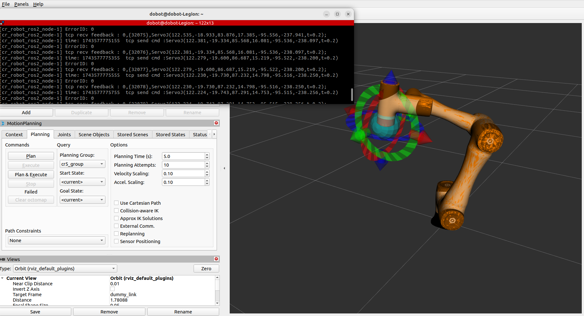

<div align="center">

 

 <h1>DOBOT 6Axis ROS2 V4</h1>

 **Dobot Robotics ROS2 Software Development Kit**  
 High-performance robot control framework based on TCP/IP protocol

 [English](README.md) · [简体中文](README_ZH.md)

 [](https://ubuntu.com/download/server)
 [](https://docs.ros.org/en/humble/)
 [](LICENSE)

</div>

---

## Quick Start

### System Requirements

| Requirement | Version |
|-------------|---------|
| OS | Ubuntu 22.04 LTS |
| ROS Version | ROS2 Humble |
| Python | 3.8+ |

### Network Configuration

| Configuration | Description |
|---------------|-------------|
| Robot IP | 192.168.5.1 (must be in the same subnet) |
| Control Port | 29999 |
| Feedback Port | 30004 |

### Installation

```bash
# Create workspace
mkdir -p ~/dobot_ws/src
cd ~/dobot_ws/src
git clone -b feature/v4-optimization https://github.com/Dobot-Arm/DOBOT_6Axis_ROS2_V4.git
cd ~/dobot_ws

# Install dependencies
sudo apt update && sudo apt install -y \
  ros-humble-moveit \
  ros-humble-gazebo-* \
  ros-humble-joint-state-publisher \
  ros-humble-robot-state-publisher

# Build
colcon build
source install/setup.bash

# Configure robot connection IP (default for wired connection)
echo "export IP_address=192.168.5.1" >> ~/.bashrc

# Specify robot model (choose according to actual model)
# Example: CR5 model
echo "export DOBOT_TYPE=cr5" >> ~/.bashrc
# Supported models: cr3, cr5, cr7, cr10, cr12, cr16, cr20, e6 (me6), cr10af, nova2, nova5, cr30h

# Apply configuration
source ~/.bashrc
```

---

## Usage

### 1. RViz Visualization (Standalone)

Visualize the robot model without a physical robot:

```bash
ros2 launch dobot_rviz dobot_rviz.launch.py
```

### 2. RViz with Real Robot

Stream live joint states from the physical robot into RViz:

```bash
# Terminal 1: Connect to robot
ros2 launch dobot_bringup_v4 dobot_bringup_ros2.launch.py

# Terminal 2: RViz with live hardware mode
ros2 launch dobot_rviz dobot_rviz.launch.py live_hardware:=true
```

### 3. MoveIt Virtual Demo

Test motion planning in RViz with a virtual controller (no robot required):

```bash
ros2 launch dobot_moveit moveit_demo.launch.py
```

### 4. MoveIt with Real Robot

Full motion planning and execution on the physical robot:

```bash
# Terminal 1: Connect to robot
ros2 launch dobot_bringup_v4 dobot_bringup_ros2.launch.py

# Terminal 2: MoveIt control interface
ros2 launch dobot_moveit dobot_moveit.launch.py
```

**Precision Control (publisher-calibrated DH accuracy)**

For point-to-point motions with calibrated-DH accuracy, use `send_pose_target.py`:

```bash
# Terminal 1: Connect to robot
ros2 launch dobot_bringup_v4 dobot_bringup_ros2.launch.py

# Terminal 2: MoveIt
ros2 launch dobot_moveit dobot_moveit.launch.py

# Terminal 3: Precision control
ros2 run dobot_moveit send_pose_target.py -- x y z rx ry rz [--plan-only]
```

**How it works:** Controller InverseKin computes joint targets → OMPL plans a
collision-free path → `action_move_server` executes via ServoJ.

| Step | IK source | Purpose |
|------|-----------|---------|
| Target IK | Controller InverseKin (calibrated DH) | TCP accuracy < 0.05 mm |
| Path planning | OMPL + joint-space constraints | Collision avoidance |
| Execution | `action_move_server` + ServoJ | Point-by-point to controller |

> `--plan-only` displays the path in RViz first; press Enter to execute.
> Use `verify_dh.py` to validate controller IK accuracy before motion.

### 5. Gazebo + MoveIt Co-Simulation

Physics simulation with motion planning:

```bash
# Terminal 1: Launch Gazebo with MoveIt controllers
ros2 launch dobot_gazebo gazebo_moveit.launch.py

# Terminal 2: Launch MoveIt control interface
ros2 launch dobot_moveit moveit_gazebo.launch.py
```

### 6. Servo Action Client

Test joint trajectory control via action client (sends single-point trajectory goals periodically):

```bash
# Terminal 1: Connect to robot
ros2 launch dobot_bringup_v4 dobot_bringup_ros2.launch.py

# Terminal 2: Start MoveIt action server
ros2 launch dobot_moveit dobot_moveit.launch.py

# Terminal 3: Run action client (sends single-point goals every second)
ros2 run servo_action action_move_client
```

---

## Launch Parameters

The following parameters apply to `dobot_rviz.launch.py`:

| Parameter | Default Value | Description |
|-----------|---------------|-------------|
| `live_hardware` | `false` | Set to `true` to get joint states from a real robot |
| `gui` | `false` | Enable `joint_state_publisher_gui` for manual joint control |
| `model` | Auto | Path to robot URDF file (auto-generated based on `DOBOT_TYPE`) |

The `dobot_moveit.launch.py` file additionally supports:

| Parameter | Default Value | Description |
|-----------|---------------|-------------|

### Environment Variables

In addition to launch parameters, the project also supports the following environment variables:

| Environment Variable | Default Source | Description |
|---------------------|---------------|-------------|
| `DOBOT_TYPE` | `param.json` | Robot type (e.g., `cr5`, `cr10`, `nova2`) |
| `IP_address` | `param.json` | Robot IP address (for real robot connection) |

---

## Project Structure

```
DOBOT_6Axis_ROS2_V4/
├── dobot_bringup_v4/        # Robot driver (TCP/IP communication)
├── dobot_moveit/            # MoveIt action server & utilities
├── dobot_rviz/              # RViz visualization launcher
├── dobot_gazebo/            # Gazebo simulation
├── dobot_demo/              # Simple motion demo scripts
├── dobot_msgs_v4/           # ROS2 service & message definitions
├── servo_action/            # Joint trajectory action client
├── cr3_moveit/              # CR3 MoveIt config
├── cr5_moveit/              # CR5 MoveIt config
├── cr7_moveit/              # CR7 MoveIt config
├── cr10_moveit/             # CR10 MoveIt config
├── cr10af_moveit/           # CR10AF MoveIt config
├── cr12_moveit/             # CR12 MoveIt config
├── cr16_moveit/             # CR16 MoveIt config
├── cr20_moveit/             # CR20 MoveIt config
├── cr30h_moveit/            # CR30H MoveIt config
├── me6_moveit/              # E6/ME6 MoveIt config
├── nova2_moveit/            # Nova2 MoveIt config
├── nova5_moveit/            # Nova5 MoveIt config
├── cra_description/         # Robot URDF/XACRO descriptions & meshes
├── image/                   # Images
├── README.md
└── README_ZH.md
```

---

## Architecture & Data Flow

### MoveIt + Real Robot

```
dobot_bringup_v4 (main.cpp)
  └→ /joint_states_robot  (10Hz, radians, from port 30004 feedback)
       └→ joint_state_relay (--robot mode)
            ├→ /joint_states           → MoveIt current_state_monitor (planning start state)
            └→ /rsp_joint_states       → robot_state_publisher  → TF  → RViz

MoveIt (OMPL / CHOMP planner)
  └→ FollowJointTrajectory Action
       └→ action_move_server (dobot_moveit package)
            └→ ServoJ service (per waypoint)  → dobot_bringup_v4  → TCP  → robot
```

### Key Components

| Component | Package | Role |
|-----------|---------|------|
| `main.cpp` | `dobot_bringup_v4` | TCP 30004 realtime feedback → `/joint_states_robot` |
| `joint_state_relay.py` | `dobot_rviz` | Bridge `/joint_states_robot` → `/joint_states`; relay → `/rsp_joint_states` |
| `action_move_server.py` | `dobot_moveit` | Receives MoveIt trajectory, sends ServoJ commands waypoint-by-waypoint |
| `cra_description` | `cra_description` | Robot URDF/XACRO descriptions and STL meshes for all models |
| `ompl_planning.yaml` | `{model}_moveit` | OMPL planner config (includes `AddTimeOptimalParameterization`) |

---

## Supported Models

| Series | Models |
|--------|--------|
| CR Series | CR3, CR5, CR7, CR10, CR12, CR16, CR20, CR30H |
| CRAF Series | CR10AF |
| E Series | E6 / ME6 |
| Nova Series | Nova2, Nova5 |

---

## Launch Files Reference

| Launch File | Description |
|-------------|-------------|
| `dobot_rviz.launch.py` | RViz visualization (standalone or with `live_hardware:=true`) |
| `dobot_bringup_ros2.launch.py` | Robot driver — TCP/IP connection to physical robot |
| `moveit_demo.launch.py` | MoveIt motion planning demo (virtual) |
| `dobot_moveit.launch.py` | MoveIt control interface (real robot) |
| `dobot_gazebo.launch.py` | Gazebo physics simulation (without controllers) |
| `gazebo_moveit.launch.py` | Gazebo + MoveIt co-simulation (with controllers) |
| `dobot_joint.launch.py` | MoveIt action server (real robot) |

## Demo & Utilities Reference

| Package | Executable | Description |
|---------|------------|-------------|
| `dobot_demo` | `demo` | Basic motion demo (MovJ/MovL/DO control) |
| `servo_action` | `action_move_client` | Joint trajectory action client (single-point goals every 1s) |
| `servo_action` | `Joint_Position` | Fake joint state publisher for simulation testing |

---

## Notes

> ⚠️ **Safety First**: Ensure the robot is in a safe position before operation

1. Ensure computer IP is in the same subnet as robot (192.168.X.X)
2. Ensure ports 29999 and 30004 are not occupied
3. Robot must be in remote TCP/IP control mode

---

## Version Information

| Information | Content |
|-------------|---------|
| Current Version | V4.6.5 |
| ROS Version | ROS2 Humble |
| Protocol Version | Dobot TCP/IP V4.6.5 |

---

## License

[MIT License](LICENSE)

<div align="center">
Built by Dobot-Arm
</div>
