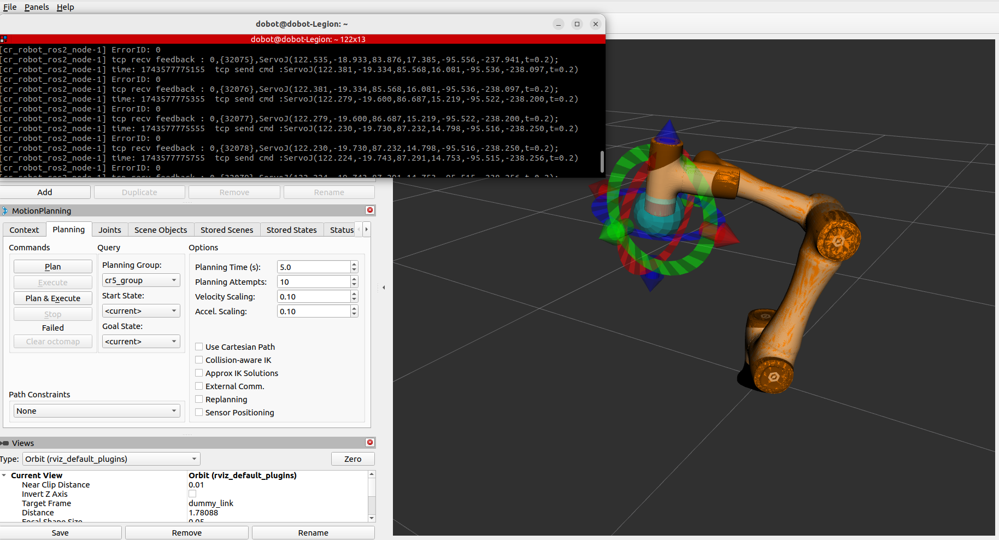

<div align="center">

 

 <h1>DOBOT 6Axis ROS2 V4</h1>

 **Dobot Robotics ROS2 Software Development Kit**
 High-performance robot control framework based on TCP/IP protocol

 [English](README.md) · [简体中文](README_ZH.md)

 [](https://ubuntu.com/download/server)
 [](https://docs.ros.org/en/jazzy/)
 [](LICENSE)

</div>

---

## Quick Start

### System Requirements

| Requirement | Version |
|-------------|---------|
| OS | Ubuntu 24.04 LTS |
| ROS Version | ROS2 Jazzy |
| Python | 3.10+ |
| Simulation | Gazebo Sim (Harmonic) |

### Network Configuration

| Configuration | Description |
|---------------|-------------|
| Robot IP | 192.168.5.1 (must be in the same subnet) |
| Control Port | 29999 |
| Feedback Port | 30004 |

### Installation

```bash
# Create workspace
mkdir -p ~/dobot_ws/src
cd ~/dobot_ws/src
git clone -b jazzy https://github.com/Dobot-Arm/DOBOT_6Axis_ROS2_V4.git
cd ~/dobot_ws

# Install dependencies
sudo apt update && sudo apt install -y \
  ros-jazzy-moveit \
  ros-jazzy-ros-gz-sim \
  ros-jazzy-ros-gz-bridge \
  ros-jazzy-gz-ros2-control \
  ros-jazzy-joint-state-publisher \
  ros-jazzy-robot-state-publisher

# Build
colcon build --symlink-install
source install/local_setup.sh
```

> For a step-by-step installation guide, see [docs/INSTALL_JAZZY_EN.md](docs/INSTALL_JAZZY_EN.md).

---

## Robot Model Switching & IP Configuration

### Switching Robot Models

The project uses the `DOBOT_TYPE` environment variable to select between different robot models. Supported values:

| DOBOT_TYPE  | Robot Model |
| ----------- | ----------- |
| `cr3`       | CR3         |
| `cr5`       | CR5 (default) |
| `cr7`       | CR7         |
| `cr10`      | CR10        |
| `cr10af`    | CR10AF      |
| `cr12`      | CR12        |
| `cr16`      | CR16        |
| `cr20`      | CR20        |
| `cr30h`     | CR30H       |
| `me6`       | E6 / ME6    |
| `nova2`     | Nova2       |
| `nova5`     | Nova5       |

Set the environment variable in your terminal (example for CR5):

```bash
export DOBOT_TYPE=cr5
```

To make it permanent, add the line above to your `~/.bashrc` file.

### Configuring Robot IP Address

The project uses the `IP_address` environment variable to pass the actual robot IP address:

```bash
export IP_address=192.168.5.1
```

> The default robot IP is `192.168.5.1`. Modify it according to your actual network setup. Make sure your computer is on the same subnet as the robot.

## Quick Launch (5 Scenarios)

Select the scenario you need. Set `DOBOT_TYPE` before any command:

```bash
export DOBOT_TYPE=cr5
```

| # | Scenario | Command |
|---|----------|---------|
| 1 | RViz visualization (robot model only) | `ros2 launch dobot_rviz dobot_rviz.launch.py` |
| 2 | MoveIt virtual simulation (no Gazebo, no hardware) | `ros2 launch dobot_moveit moveit_demo.launch.py` |
| 3 | Gazebo simulation only (no MoveIt) | `ros2 launch dobot_gazebo dobot_gazebo.launch.py` |
| 4 | **Gazebo + MoveIt** joint simulation | `ros2 launch dobot_gazebo sim.launch.py` |
| 5 | **MoveIt + real robot** (hardware required) | see below |

> **Scenario 4 (Gazebo + MoveIt):** `sim.launch.py` starts Gazebo, MoveGroup and RViz together in one command.
> Alternatively, launch them separately in two terminals:
> ```bash
> # Terminal 1
> ros2 launch dobot_gazebo dobot_gazebo.launch.py
> # Terminal 2
> ros2 launch dobot_moveit moveit_gazebo.launch.py
> ```

### Scenario 5: MoveIt + Real Robot

```bash
# 1. Set robot model and IP
export DOBOT_TYPE=cr5
export IP_address=192.168.5.1

# 2. Launch robot driver (Terminal 1)
ros2 launch dobot_bringup_v4 dobot_bringup_ros2.launch.py

# 3. Launch MoveIt control interface (Terminal 2)
ros2 launch dobot_moveit dobot_moveit.launch.py
```

### Optional: Motion Demo

After Scenario 5 is running, you can execute a sample motion sequence (EnableRobot + MovJ):

```bash
ros2 run dobot_demo demo
```

---

## Architecture

### Data Flow (Real Robot)

```
Physical Robot (TCP/IP)
  ├─ 192.168.5.1:29999  ← control commands (dashboard)
  └─ 192.168.5.1:30004  → 1440-byte binary RealTimeData @100Hz (feedback)

dobot_bringup_v4 (C++ node "dobot_bringup_ros2")
  ├─ CRCommanderRos2: owns two TcpClient instances, recvTask reads feedback
  ├─ CRRobotRos2: ~124 ROS2 services → parseTool → TCP command string → robot
  ├─ Publishes: /joint_states_robot, /dobot_msgs_v4/msg/RobotStatus,
  │             /dobot_msgs_v4/msg/ToolVectorActual
  └─ ~124 services on: /dobot_bringup_ros2/srv/<Name>

dobot_moveit (Python)
  ├─ joint_states.py: relays /joint_states_robot → /joint_states (MoveIt standard)
  └─ action_move_server.py: FollowJointTrajectory action → ServoJ service calls
```

### ROS2 Interface Reference

| Topic / Service | Type | Publisher / Server | Description |
|-----------------|------|--------------------|-------------|
| `/joint_states_robot` | `sensor_msgs/JointState` | `dobot_bringup_v4` | Joint feedback from real robot |
| `/joint_states` | `sensor_msgs/JointState` | `dobot_moveit` (relay) | Standard MoveIt joint states |
| `/dobot_msgs_v4/msg/RobotStatus` | `dobot_msgs_v4/RobotStatus` | `dobot_bringup_v4` | Robot enable/connect status |
| `/dobot_msgs_v4/msg/ToolVectorActual` | `dobot_msgs_v4/ToolVectorActual` | `dobot_bringup_v4` | Tool pose (x,y,z,rx,ry,rz) |
| `/{robot}_group_controller/follow_joint_trajectory` | `control_msgs/FollowJointTrajectory` | `dobot_moveit` | MoveIt trajectory execution |
| `/dobot_bringup_ros2/srv/<Name>` | `dobot_msgs_v4/srv/<Name>` | `dobot_bringup_v4` | ~124 robot control services |

---

## Project Structure

```
DOBOT_6Axis_ROS2_V4/
├── dobot_bringup_v4/        # C++ TCP/IP driver, ~124 services + feedback publisher
├── dobot_moveit/            # Python: MoveIt action server + joint state relay
├── dobot_rviz/              # RViz viz + shared URDF/meshes (dependency of all *_moveit)
├── dobot_gazebo/            # Gazebo Sim launch + custom controller_loader
├── dobot_demo/              # Motion demo scripts (MovJ/MovL/DO)
├── dobot_msgs_v4/           # ROS2 msg/srv definitions (2 msg + ~124 srv)
├── servo_action/            # Joint trajectory action client demo
├── cr3_moveit/              # CR3 MoveIt config (URDF/SRDF/YAML/launch)
├── cr5_moveit/              # CR5 MoveIt config
├── cr7_moveit/              # CR7 MoveIt config
├── cr10_moveit/             # CR10 MoveIt config
├── cr10af_moveit/           # CR10AF MoveIt config
├── cr12_moveit/             # CR12 MoveIt config
├── cr16_moveit/             # CR16 MoveIt config
├── cr20_moveit/             # CR20 MoveIt config
├── cr30h_moveit/            # CR30H MoveIt config
├── me6_moveit/              # E6/ME6 MoveIt config
├── nova2_moveit/            # Nova2 MoveIt config
├── nova5_moveit/            # Nova5 MoveIt config
├── cra_description/         # Xacro + meshes for Gazebo simulation
├── misc/                    # FK.py, TF.py helpers + TCP/IP protocol PDF
├── docs/                    # Installation guides (INSTALL_JAZZY.md)
├── V4新增指令/              # V4 new instruction docs (Chinese)
├── image/                   # Documentation images
├── README.md
└── README_ZH.md
```

### Package Dependencies

```
dobot_rviz ──(URDF/meshes)──▶ *_moveit (12 pkgs) ──▶ dobot_moveit
cra_description ──(xacro)──▶ dobot_gazebo
dobot_msgs_v4 ──(msg/srv)──▶ dobot_bringup_v4, dobot_moveit, dobot_demo, servo_action
```

> **Note:** `dobot_rviz` is not only for visualization. Its `urdf/*.urdf` files are referenced by every `*_moveit` config via `$(find dobot_rviz)/urdf/<model>_robot.urdf`. Removing it breaks all MoveIt packages.

---

## Driver Configuration

The real-robot driver reads `dobot_bringup_v4/config/param.json`:

```json
{
  "robot_number": 1,
  "current_robot": 1,
  "node_info": [
    {
      "ip_address": "192.168.5.1",
      "robot_type": "cr5",
      "trajectory_duration": 0.3,
      "robot_node_name": "dobot_bringup_ros2"
    }
  ]
}
```

Environment variables take precedence over `param.json`:
- `DOBOT_TYPE` overrides `robot_type`
- `IP_address` overrides `ip_address`

For multi-robot setups, increase `robot_number` and add entries to `node_info`; `current_robot` selects which one to launch.

---

## Supported Models

| Series | Models |
|--------|--------|
| CR Series | CR3, CR5, CR7, CR10, CR12, CR16, CR20, CR30H |
| CRAF Series | CR10AF |
| E Series | E6 / ME6 |
| Nova Series | Nova2, Nova5 |

---

## Launch Files

| Launch File | Package | Description |
|-------------|---------|-------------|
| `dobot_bringup_ros2.launch.py` | `dobot_bringup_v4` | Launch robot driver (hardware) |
| `dobot_rviz.launch.py` | `dobot_rviz` | RViz visualization (robot model only) |
| `moveit_demo.launch.py` | `dobot_moveit` | MoveIt virtual demo (fake controller) |
| `dobot_moveit.launch.py` | `dobot_moveit` | MoveIt control (real robot, with action_server) |
| `moveit_gazebo.launch.py` | `dobot_moveit` | MoveIt side for Gazebo simulation |
| `dobot_gazebo.launch.py` | `dobot_gazebo` | Gazebo simulation (robot + ros2_control) |
| `sim.launch.py` | `dobot_gazebo` | Gazebo + MoveIt one-click launch |

---

## Notes

> ⚠️ **Safety First**: Ensure the robot is in a safe position before operation

1. Ensure computer IP is in the same subnet as robot (192.168.X.X)
2. Ensure ports 29999 and 30004 are not occupied
3. Robot must be in remote TCP/IP control mode

---

## Troubleshooting

| Symptom | Cause / Solution |
|---------|------------------|
| `EnableRobot service not available` | Driver not started. Run Scenario 5 step 2 first, or check `IP_address` is reachable (`ping 192.168.5.1`). |
| RViz model jumps up and down | Another machine on the LAN publishes conflicting `/tf`. `dobot_rviz.launch.py` already sets `ROS_LOCALHOST_ONLY=1`; ensure you did not override it. |
| MoveIt `GOAL_TOLERANCE_VIOLATED` | Trajectory execution timeout exceeded. Increase `trajectory_execution_timeout` (default 120s) when moving to `dobot_moveit/launch/dobot_joint.launch.py`. |
| Gazebo controllers fail to load | `controller_loader.py` polls hardware interfaces; if it times out, the GPU/CPU is too slow. Launch with `gui:=false` to reduce load. |
| Build fails on `dobot_msgs_v4` | Build it first: `colcon build --packages-select dobot_msgs_v4`, then build the rest. |
| Service call returns `res != 0` | The robot returned an error. Call `ros2 service call /dobot_bringup_ros2/srv/ClearError dobot_msgs_v4/srv/ClearError` and retry. |

---

## Version Information

| Information | Content |
|-------------|---------|
| Current Version | V4.6.5 |
| ROS Version | ROS2 Jazzy |
| Protocol Version | Dobot TCP/IP V4.6.5 |
| Simulation | Gazebo Sim (Harmonic) |

---

## License

[MIT License](LICENSE)

<div align="center">
Built by Dobot-Arm
</div>
